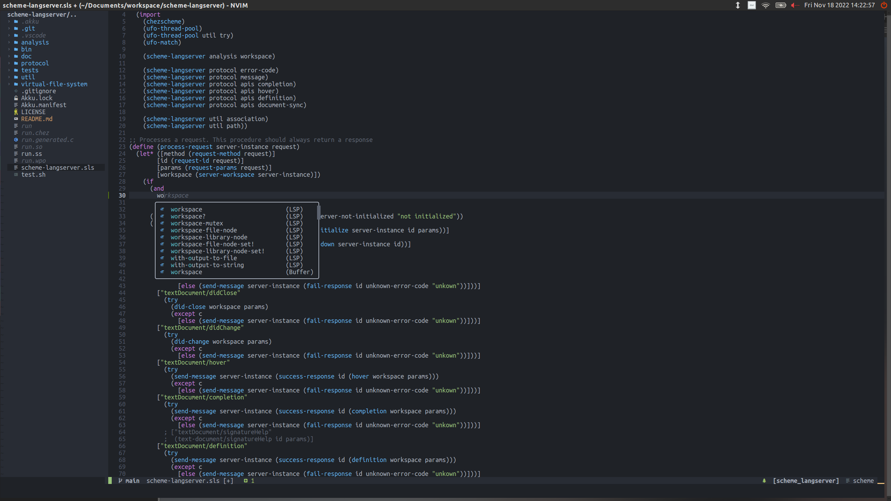
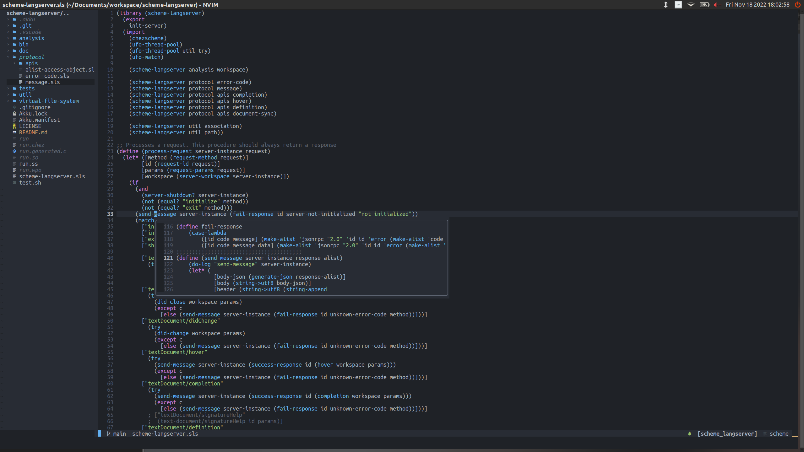
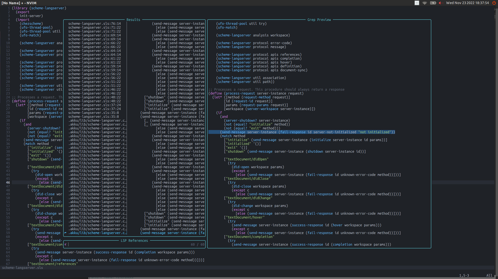
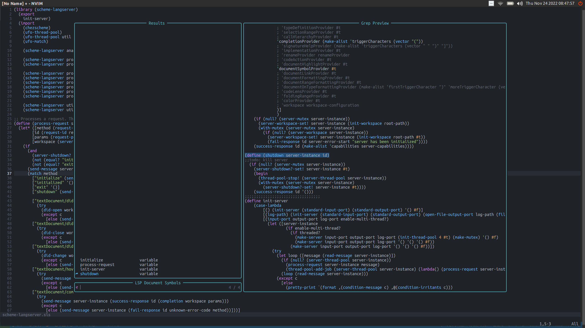
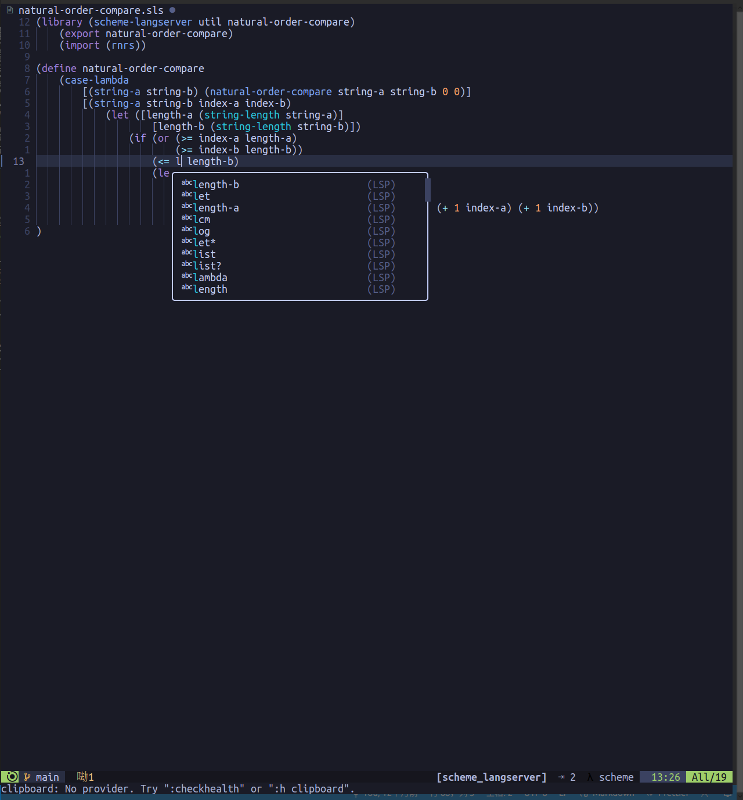
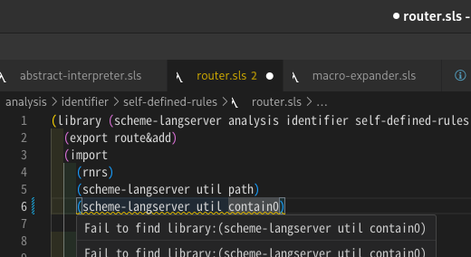

# Scheme-langserver

[](https://deepwiki.com/ufo5260987423/scheme-langserver)

You may read my [paper](./doc/paper.pdf) and cite like this:

> WANG, Z. (2025, May 12). Scheme-langserver: Treat Scheme Code Editing as the First-Class Concern. The 18th European Lisp Symposium (ELS`25), Zurich. https://doi.org/10.5281/zenodo.15384882

Due to occasional GitHub access restrictions from China, this repository is also mirrored on [Codeberg](https://codeberg.org/ufo5260987423/scheme-langserver) and [Gitee](https://gitee.com/ufo5260987423/scheme-langserver). I collaborate with [XmacsLabs](https://github.com/XmacsLabs); a fork is available [here](https://github.com/XmacsLabs/scheme-langserver).

<video src="https://github.com/user-attachments/assets/893bba98-6709-4fac-a4d3-dc7b6aab46fb" controls="controls" width="500" height="300"></video>

**VSCode is now supported!** See the [setup guide](./doc/build-and-startup.md).

> **Note:** Auto-generated type information is available [here](https://ufo5260987423.github.io/scheme-langserver/doc/analysis/type-inference-result). It is mainly used for downstream development and debugging.

Implementing IDE features like autocomplete, goto definition, and hover documentation is a significant effort. Compared to languages like Java, Python, JavaScript, or C, language server implementations for Lisp dialects are still scarce. Existing tools such as [Geiser](https://gitlab.com/emacs-geiser), [racket langserver](https://github.com/jeapostrophe/racket-langserver), and [swish-lint](https://github.com/becls/swish-lint) rely primarily on a REPL or keyword tokenization rather than static program analysis.

For example, when editing an incomplete project whose code is not yet fully executable, Geiser can only complete top-level bindings listed by `environment-symbols` (on Chez Scheme) or raw symbols—not true identifiers. This means local bindings and unfinished code receive no help in recognizing valid identifier scopes. The same limitation applies to goto definition and other core IDE features.

The root cause is that Scheme and other Lisp dialects present a formidable challenge for program analysis: their rich data structures, flexible control flow, and especially macros make static reasoning difficult. But this does not mean Scheme is only for geniuses and meta-programming. With a better editing environment, Scheme can be accessible and productive for everyone.

**scheme-langserver** is a Language Server Protocol (LSP) implementation for Scheme that provides completion, goto definition, hover, and type inference through static code analysis based on the [R6RS standard](http://www.r6rs.org/), with switchable top environments for **R6RS, R7RS, [S7](https://ccrma.stanford.edu/software/snd/snd/s7.html), and Fluent Scheme** (Ansys Fluent's embedded Petite Chez Scheme). It handles incomplete code gracefully and is published via [Akku](https://akkuscm.org/), a Scheme package manager.

The server has been tested on [Chez Scheme](https://cisco.github.io/ChezScheme/) 9.4, 9.5, and 10.x.

## Compilation, Installation & Configuration
See the [setup guide](./doc/build-and-startup.md).

## Workspace Cache

scheme-langserver can persist the analyzed workspace state to a Chez FASL cache so
that subsequent restarts skip the expensive `init-references` phase. Enable it
with the `--cache-path` option:

```bash
./run --cache-path ~/.cache/scheme-langserver
```

The cache file is written to `<cache-path>/workspace.fasl`. It is saved when the
server receives a normal LSP `exit` or `shutdown` request; if the process
crashes or is killed, the previously saved cache remains usable. The cache is
keyed by a manifest that includes the langserver version, Chez version, machine
type, and record-layout fingerprint; any mismatch falls back to a cold start.
Because Chez FASL is platform-specific, **do not share the cache file across
machines or Chez versions**. When only a few files have changed since the cache
was saved, the server performs an incremental refresh and preserves the analysis
results for unchanged files.

Typical numbers (measured 2026-10-30, min of 3 runs, identifier analysis only,
macro resolution off):

| Fixture | Cold startup | Cached startup | Speedup |
|---------|--------------|----------------|---------|
| simple-lib (2 files) | ~3 ms | ~2 ms | ~1.5x |
| Synthetic 100 independent simple-lib copies (200 files) | ~407 ms | ~49 ms | ~8x |
| scheme-langserver itself | ~0.1–0.4 s | ~300 ms | ~break-even |

Since the 2026-10 analysis caches (import-set caching, negative caching of
unexpandable call sites, expansion budgets), cold initialization is fast enough
that the cache is close to break-even at init for small workspaces — the FASL
read plus the per-file mtime sweep costs about as much as re-analysis. It still
pays off on larger workspaces and through persisted diagnostics, which are
republished immediately after a cache load without re-diagnosing files.

See [doc/analysis/workspace.md](./doc/analysis/workspace.md) §8 and
[AGENTS.md](./AGENTS.md) §11 for implementation details.

## File Filter

By default scheme-langserver uses the Akku package manager's file list to decide
which files belong to the workspace. For projects without Akku, or for
non-standard file extensions, choose one of the following mutually exclusive
options:

* `--package-manager` (or `-p`) selects a preset:

  ```bash
  ./run -p akku                  # Akku-managed files (default)
  ./run -p txt                   # Only .scm.txt files
  ```

* `--file-filter` (or `-f`) gives an exact extension list. It can be repeated
  and the extensions are merged automatically; leading dots are optional:

  ```bash
  ./run -f ".sls,.scm,.ss,.sld,.scm.txt"
  ./run -f scm.txt -f scm -f sls
  ./run -f sls -f scm -f sps -f ss -f sld
  ```

`-p` and `-f` cannot be used together. The resolved filter is persisted in the
workspace-cache manifest, so changing the filter invalidates any previously saved
cache.

## Debugging
For troubleshooting tips, see [debugging.md](./doc/testing/debugging.md).

## Release
2.1.11 — Macro release: automatic macro resolution is rebuilt on Chez's own expander IR (route-2 pipeline retired), now covering `match-index-node` and any library-resolved user macro, opt-in via `-a`/`--auto-expand`; macro-aware type inference with resource controls makes whole-repo type inference feasible (was OOM); macro expansion in compiled binaries fixed; the ~38 s cold-start issue resolved.
2.1.10 — Bug-fix release hardening the tokenizer: files with content after `#!eof` and files whose first datum is not a parenthesized form no longer fail the whole workspace initialize; adds the Fluent Scheme top environment.
Active development is focused on bug fixes, performance profiling, and expanding the type inference system.

See [doc/release-history.md](./doc/release-history.md) for older releases.

## Features
1. Completion for top-level and local identifier bindings.

2. Goto definition.

3. Compatible with package manager: Akku.
4. File-change synchronization with corresponding index updates.
5. Hover.
6. References and document highlights (document-scoped).

7. Document symbol.

8. **Workspace symbol search** (`workspace/symbol`).
9. Catching local identifier bindings in `define-syntax`, `let-syntax`, and other macro forms via hand-written rules.
10. **Automatic macro resolution** (opt-in via `-a` / `--auto-expand`). Macro call sites are expanded by Chez's own expander and the resulting IR is mined for bindings and references — macro-agnostic, covering the `ufo-match` family, `match-index-node`, and any library-resolved user macro. Paired with expansion-driven macro type inference that closes the value-flow chain through pattern variables. See the [mechanism walkthrough](./doc/analysis/ir-auto-route-walkthrough.md).
11. Cross-platform parallel indexing.
12. Custom source-code annotator compatible with `.sps` files.
13. Peephole optimization for API requests using suspendable tasks.
14. Type inference via a homemade DSL interpreter, now integrated into auto-completion. Parameters whose types match the expected signature are ranked higher, as shown below where `length-a` and `length-b` (both `integer?`) appear first because they match the parameter type required by `<=`.

15. Supports R6RS, R7RS, [S7](https://ccrma.stanford.edu/software/snd/snd/s7.html), and Fluent Scheme (Ansys Fluent's embedded Petite Chez Scheme) by switching top environments.

```bash
send-message
2023 11 21 11 26 41 967266866
{"jsonrpc":"2.0","id":"3","result":[{"label":"length-a"},{"label":"length-b"},{"label":"lambda"},{"label":"latin-1-codec"},{"label":"lcm"},{"label":"least-fixnum"},{"label":"length"},{"label":"let"},{"label":"let*"},{"label":"let*-values"},{"label":"let-syntax"},{"label":"let-values"},{"label":"letrec"},{"label":"letrec*"},{"label":"letrec-syntax"},{"label":"lexical-violation?"},{"label":"list"},{"label":"list->string"},{"label":"list->vector"},{"label":"list-ref"},{"label":"list-sort"},{"label":"list-tail"},{"label":"list?"},{"label":"log"},{"label":"lookahead-char"},{"label":"lookahead-u8"}]}
```
16. Abstract interpreter that resolves identifiers across multiple file extensions: `.scm`, `.ss`, `.sps`, `.sls`, `.sld`.
17. Code diagnostics with LSP-standard `source` and `code` fields. Detects library-not-found, duplicate identifiers in binding forms (e.g. `(lambda (x x) ...)`), unused imports (e.g. `(only (rnrs) car)` where `car` is never referenced), and tokenizer syntax errors.


### Roadmap
18. Renaming support (`textDocument/rename` + `prepareRename`).
19. Formatting (`textDocument/formatting`).
20. Signature help (`textDocument/signatureHelp`).
21. Code actions (`textDocument/codeAction`) — e.g. "Remove unused import", "Organize imports".
22. Full R6RS compatibility.
23. Step-by-step macro expander for self-defined macros.
24. Code evaluation within the language server.
25. Cross-language semantic support via AST transformers.
26. Extract expression/statement into a procedure (refactoring).

## Contributing
Pull requests are welcome! Please see [AGENTS.md](./AGENTS.md) for project conventions, build steps, and coding style before opening a PR.

### Vibe Coding with KIMI
Since mid-2025, active development on this project has been assisted by [KIMI](https://kimi.moonshot.cn/) (Moonshot AI) in a vibe-coding workflow: the maintainer describes intent in natural language, KIMI explores the codebase, proposes changes, and iterates with tests. If you notice commits authored or co-authored by `kimi`, that is the AI agent trail. Human review and final approval always remain with the maintainer.

## Testing
Almost all key procedures and APIs are covered by tests. Run the full suite with:
```bash
bash test.sh
```
For faster feedback during development, run a single test file:
```bash
source .akku/bin/activate
scheme --script tests/protocol/apis/test-definition.sps
```
> **Note:** Tests currently focus on single-threaded execution.
> **Note:** `tests/robustness/robustness-concurrent.sps` (multi-threaded) used to fail intermittently with `Exception in thread-loop: ... no fail-handler` followed by a hang. The root cause was a non-tail-recursive wait loop in `request-queue-pop` (each recursive frame dequeued again, consuming tasks twice), diagnosed via [cisco/ChezScheme#1055](https://github.com/cisco/ChezScheme/issues/1055). Fixed in 2.1.10.

## Other Use Cases
### Script-Fu in GIMP
Script-Fu is based on Scheme. Using [this example](https://dalelane.co.uk/blog/?p=628), you can apply scheme-langserver to `.scm` files in GIMP.

### Other Potential Targets

Possible future targets include [OMN (Opusmodus Notation)](https://opusmodus.com/) and AutoLisp.

## Code Count
```bash
find . -name "*.sls" ! -path "./.akku/*" |xargs wc -l
```
## Detailed Document

### Core Analysis
1. [Catching identifier bindings](./doc/analysis/identifier.md) — how the abstract interpreter resolves `define`, `lambda`, `let`, `define-record-type`, etc.
2. [Macro auto-resolution](./doc/analysis/ir-auto-route-walkthrough.md) — how macro call sites are expanded by Chez's expander and mined for bindings/references (per-stage code map)
3. [Type system & inference](./doc/analysis/type/type.md) — complete type-inference pipeline and DSL
4. [Workspace lifecycle](./doc/analysis/workspace.md) — initialization, incremental updates, and refresh batches
5. [File dependency graph](./doc/analysis/dependency/file-linkage.md) — topological sorting and linkage matrix

### Protocol & Concurrency
6. [API request scheduling](./doc/protocol/analysis/request-queue.md) — request queue, engine time-slicing, cancellation, and document-sync protection
7. [Diagnostic publication](./doc/protocol/diagnostic.md) — how diagnostics are generated, accumulated, and sent

### Debugging & Development
8. [Debugging guide](./doc/testing/debugging.md) — enable logs, replay logs, and iterative printf debugging
9. [Development guide (中文)](./doc/development-guide.md) / [English version](./doc/development-guide-en.md)
10. [AGENTS.md](./AGENTS.md) — build steps, testing conventions, coding style, and common traps for contributors

### User Guides
11. [Fluent Scheme support](./doc/fluent-scheme.en.md) — using Magic Scheme + scheme-langserver for Ansys Fluent Scheme development in VS Code ([中文版](./doc/fluent-scheme.md))

### Research & Experiments
12. [Scheme-langserver paper (ELS'25)](./doc/paper.pdf) — academic paper on static analysis for Scheme
13. [Macro analysis framework](./doc/analysis/macro-analysis-framework.md) — theoretical coordinates of the macro-analysis mechanisms (with the retired route-2 pipeline as reference)
14. [Syntax candy DSL](./doc/analysis/type/domain-specific-language/syntax-candy.md) — pattern matcher for type-rule authoring
15. [Record type inference analysis](./doc/analysis/type/record-inference.md) — `define-record-type` in the type system
16. [Type inference performance field notes](./doc/analysis/type/type.md#103-performance-optimization-attempts-field-notes) — benchmark methodology and dead-end records
17. [DeepWiki](https://deepwiki.com/ufo5260987423/scheme-langserver)

## License
[MIT](./LICENSE)

## Star History

[](https://star-history.com/#ufo5260987423/scheme-langserver)

## Contributors

